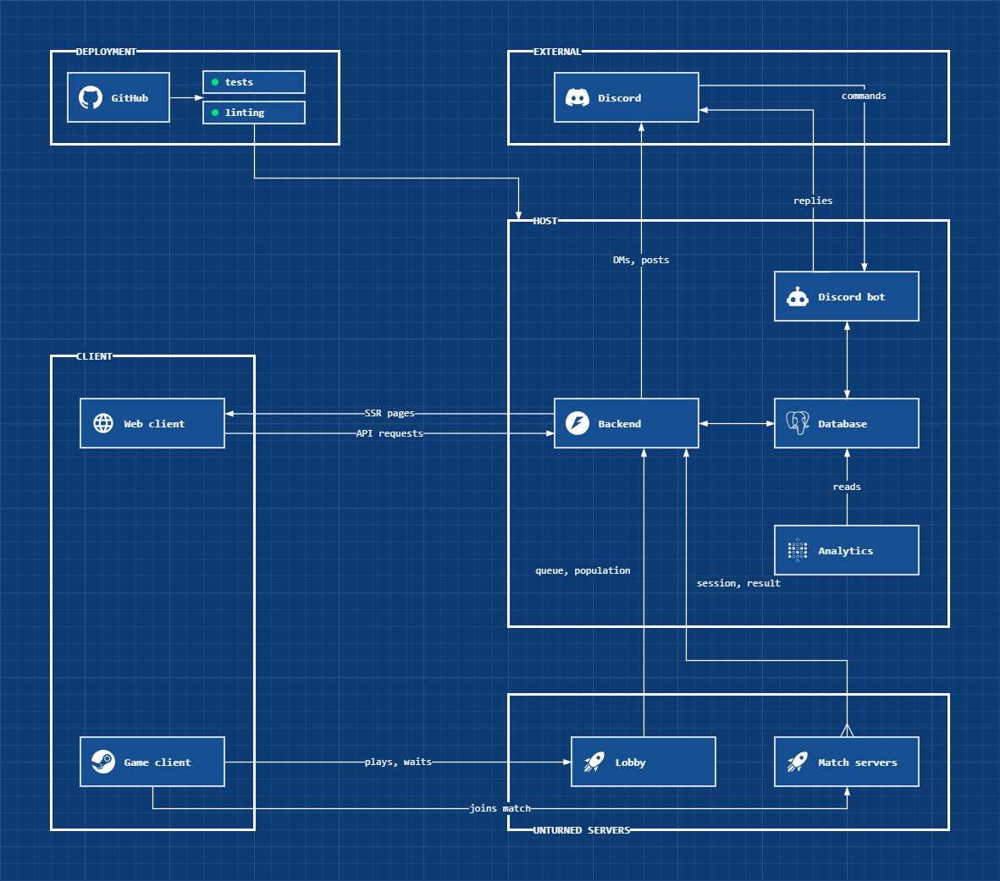
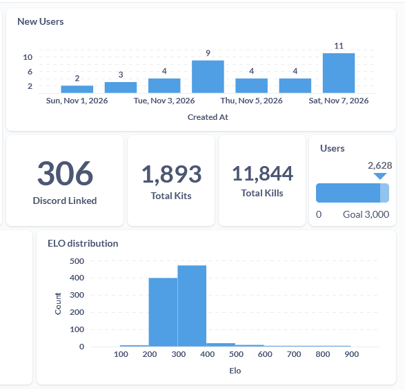

PeekSeek is a ranked matchmaking platform for the game Unturned, with more than 2,600 users. One engineer operates it. This article examines two decisions: where the system operates, and which data the operator measures.



*Figure 1. The PeekSeek architecture.*

## Three hosting models

1. **A VPS with nginx.** Cheap and easy to understand. But each change needed manual work on the server.
2. **A managed platform.** It removed the manual work. But the cost increased with each service and each database.
3. **A dedicated server with Dokploy.** Dokploy is an open-source platform that deploys Docker containers. It gives most functions of a managed platform at the fixed price of one server.

All three models used the same parts: backend, database, Discord bot and analytics. Only the host changed. Good infrastructure did not add complexity. It removed work.

## Two analytics tools

Google Analytics measures web traffic. But most activity on PeekSeek occurs in the game, and search traffic was not important. Thus it did not answer the important questions.

The important data was already in the database. Metabase reads the database directly, with no additional pipeline. A panel is one SQL query, for example new users per day:

```sql
SELECT date_trunc('day', created_at) AS day,
       count(*)                      AS new_users
FROM users
GROUP BY day
ORDER BY day;
```

Now there are panels for almost all parts of the platform.



*Figure 2. Part of the PeekSeek Metabase dashboard, November 2026.*

## Conclusion

Start with the simplest host that works, and change it only for a real problem. Measure the data that describes the product, not the data that a tool makes easy to collect.
